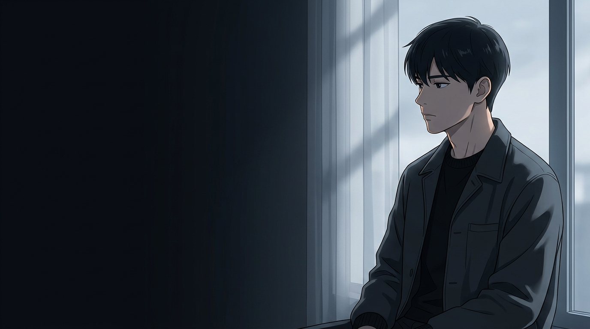

  

---

  

## About Me

- Fullstack developer building local-first desktop and mobile apps, web applications, and generative typography tools.
- Mostly working with TypeScript, React, Tauri (Rust), and Laravel across user interfaces and backend services.
- Recent builds: [ReadTrack](https://github.com/yanhaizhou21-a11y/readtrack) (offline document reader), [DDT](https://github.com/yanhaizhou21-a11y/DDT) (personal daily ledger), [Type-motion](https://github.com/yanhaizhou21-a11y/Type-motion) (procedural botanical poster studio), and [BotaniSeed](https://github.com/yanhaizhou21-a11y/LPBS).
- Designing interfaces, motion studies, and visual assets in Figma, Affinity, Canva, and Paper Design.
- Portfolio: [yanhai-portofolio.vercel.app](https://yanhai-portofolio.vercel.app)
- Reach me at [yanhaizhou21@gmail.com](mailto:yanhaizhou21@gmail.com)

  
  
  

## Tech Stack

- **Languages**

  
  
  
  
  
  
  

- **Frameworks & Motion**

  
  
  
  
  
  
  
  
  

- **Databases & Storage**

  
  
  
  
  

- **Design**

  
  
  
  

- **Tooling**

  
  
  
  
  
  

## GitHub Stats

  
  

  

  <picture>
    <source media="(prefers-color-scheme: dark)" srcset="https://raw.githubusercontent.com/yanhaizhou21-a11y/yanhaizhou21-a11y/output/superman-flight-dark.svg" />
    <source media="(prefers-color-scheme: light)" srcset="https://raw.githubusercontent.com/yanhaizhou21-a11y/yanhaizhou21-a11y/output/superman-flight.svg" />
    
  </picture>

> "Life has more trouble than you think. Build quiet tools that hold up under it."
